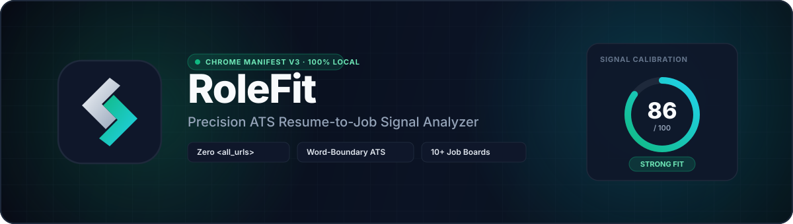
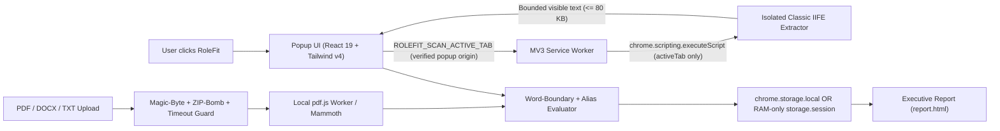

<div align="center">



<br />
<br />

[](https://github.com/riteshbonthalakoti/RoleFit/actions/workflows/ci.yml)
[](https://github.com/riteshbonthalakoti/RoleFit/actions/workflows/security.yml)
[](./public/manifest.json)
[](./tsconfig.json)
[](./vite.config.ts)
[](./LICENSE)

**Transparent, word-boundary ATS resume matching directly inside Chrome — 100% local, zero servers, zero broad permissions.**

[Why RoleFit](#-why-rolefit) · [Architecture](#-architecture--security-flow) · [Supported Boards](#-supported-job-boards) · [Quick Start](#-quick-start) · [Security](#-security--privacy-guarantees)

</div>

---

## Why RoleFit?

Most online resume checkers force you to upload personal resumes (PII) to remote servers, hide behind paywalls, or use naive substring matching that scores `JavaScript` as `Java` and drops `C` or `C++` completely.

| Capability | Typical Web ATS Checkers | RoleFit |
| :--- | :--- | :--- |
| **Data Privacy** | Uploads your PDF/DOCX to cloud servers | **100% local** in Chrome — zero network calls |
| **Extension Permissions** | Static `<all_urls>` across every tab you visit | **Least-privilege MV3** (`activeTab` on click only) |
| **Word-Boundary Engine** | Substring bugs (`JavaScript` → `Java`, `can` → `CAN`) | **Boundary + Case-Aware** (`C`, `C++`, `C#`, `CAN`, `Go`) |
| **Synonym Resolution** | Penalizes valid equivalents | **Bidirectional aliases** (`BLE` ↔ `Bluetooth Low Energy`, `K8s` ↔ `Kubernetes`) |
| **Hardware & AI Systems** | Generic web-dev keyword lists | **Curated taxonomy** for Software, AI/GPU (`CUDA`, `TensorRT`, `Jetson`) & Embedded/ECE (`FreeRTOS`, `STM32`, `BLE`, `Verilog`) |
| **Multi-Resume Workflow** | Re-upload every time you switch tracks | **Up to 5 local profiles** + **RAM-Only Private Session Mode** |

---

## Key Features

- **3-Tab Precision Popup UI:** Switch cleanly between **Overview** (radial fit gauge, dimension bars, occurrence-weighted skill gaps), **Skills** (live search, status & area filters, synonym badges), and **Profiles** (up to 5 resumes + RAM-only mode + recent history).
- **Executive Full-Page Report:** Split-column dashboard with KPI signal strip, interactive filtering, **Copy Missing Skills**, **Export Markdown (`.md`)**, **Export JSON (`.json`)**, and clean **Print / PDF** output.
- **Hardened Untrusted File Parsing:** Parses `PDF`, `DOCX`, and `TXT` resumes locally using magic-byte header validation (`%PDF-`, `PK\x03\x04`), strict file-size & page limits, DOCX ZIP-bomb/path-traversal pre-flight inspection, and a locally bundled `pdf.worker.min.mjs`.
- **Proportional Weighted Scoring:** Scores `0–100` across `Core Technical`, `Tools & Platforms`, `Role & Seniority`, `Education & Certs`, and `Collaboration` so missing one soft skill never collapses a strong engineering match.

---

## Architecture & Security Flow



---

## Supported Job Boards

| Category | Platforms |
| :--- | :--- |
| **Global Tech & ATS** | LinkedIn Jobs · Greenhouse · Lever · Workday · Indeed · Ashby |
| **AI & Hardware Portals** | NVIDIA / Eightfold (`jobs.nvidia.com`, `eightfold.ai`) |
| **Startups & India Hiring** | Wellfound · Naukri · Internshala |
| **Universal Fallback** | Generic semantic career-page detector + **Manual Paste JD** mode |

---

## Quick Start

### 1. Build Locally
```bash
git clone https://github.com/riteshbonthalakoti/RoleFit.git
cd RoleFit
npm install
npm run build
```

### 2. Load Unpacked in Chrome
1. Navigate to `chrome://extensions/`
2. Enable **Developer mode** (top right)
3. Click **Load unpacked** and select the `dist/` directory
4. Pin **RoleFit** to your Chrome toolbar and click it on any job posting

---

## Development, Testing & Release Pipeline

```bash
npm run typecheck      # Strict TypeScript check
npm run lint           # ESLint with security rules (no-eval, no-script-url)
npm test               # Vitest engine + security regression suite
npm run test:coverage  # Coverage report
npm run build          # Production build + MV3 Manifest Security Policy Gate
npm run package        # Deterministic Chrome Web Store .zip + SHA256SUMS.txt
```

### Automated Quality & Security Gates
- **CI (`.github/workflows/ci.yml`):** Typecheck, ESLint, Vitest coverage, Vite 8 production build, and `scripts/verify-manifest.mjs` (fails CI if `<all_urls>`, `unsafe-eval`, ES `import` in `content.js`, or `.map` source maps ever enter `dist/`).
- **Security (`.github/workflows/security.yml`):** `npm audit --omit=dev --audit-level=high` (`0` production vulnerabilities), CodeQL (`security-extended`), and Dependabot weekly updates.
- **Releases (`.github/workflows/release.yml`):** Tagging `v*` automatically builds and publishes a reproducible `rolefit-vX.Y.Z-chrome.zip` and `SHA256SUMS.txt`.

---

## Security & Privacy Guarantees

- **Zero External Network Calls:** Every PDF/DOCX parse and ATS evaluation happens strictly inside your local Chrome instance.
- **Zero Static `<all_urls>` Injection:** No background script ever touches your tabs unless you click the RoleFit icon.
- **Strict CSP & Input Validation:** `script-src 'self'; object-src 'none'; base-uri 'none'; frame-ancestors 'none'`, strict `sender.id` + `popup.html` sender validation, exact domain suffix matching, and `http(s)://`-only external link sanitization.
- Read full documentation in [PRIVACY.md](./PRIVACY.md) and [SECURITY.md](./SECURITY.md).

---

## License

MIT — see [LICENSE](./LICENSE).
